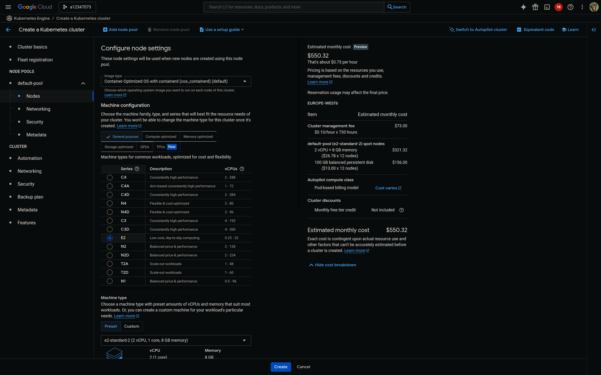
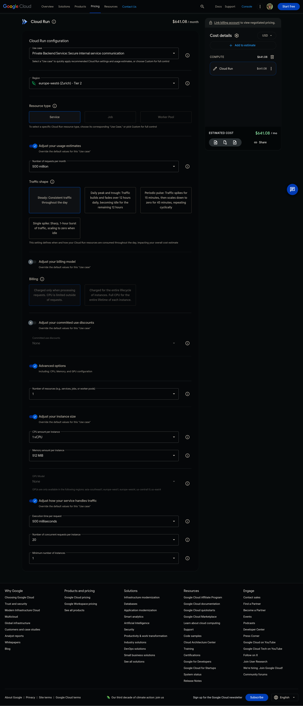
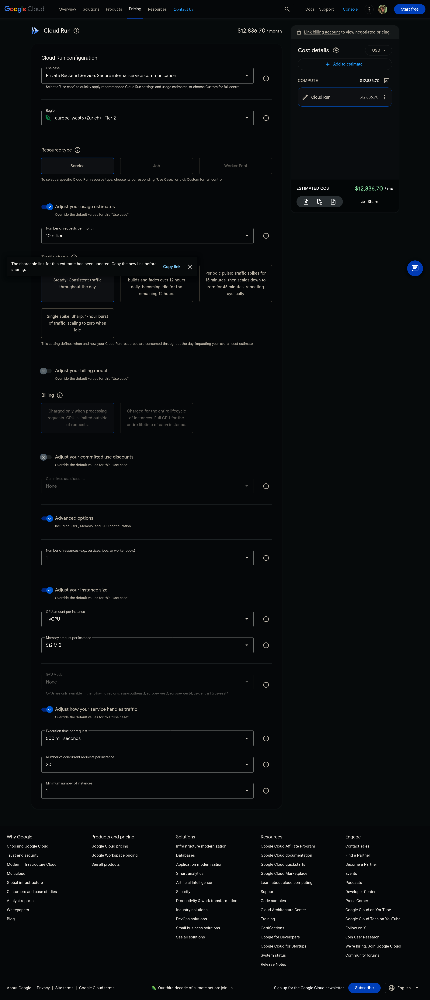

# Cost Estimations Using GCP Pricing Calculator

## Resource Requirements Summary

| Service         | Replicas | CPU Request | CPU Limit | Memory Request | Memory Limit |
| --------------- | -------- | ----------- | --------- | -------------- | ------------ |
| **Collector**   | 2        | 250m        | 500m      | 64Mi           | 128Mi        |
| **Section**     | 1        | 250m        | 500m      | 128Mi          | 128Mi        |
| **Alert**       | 1        | 250m        | 500m      | 128Mi          | 128Mi        |
| **Recognition** | 1-3      | 500m        | 750m      | 512Mi          | 1024Mi       |
| **Analysis**    | 1-3      | 500m        | 750m      | 512Mi          | 1024Mi       |
| **Camera**      | 1        | 500m        | 500m      | 128Mi          | 128Mi        |

**Total Resource Requirements:**
- **Average Load (Requests):** ~5 vCPU, ~4GB RAM
- **Peak Load (Limits):** ~7 vCPU, ~7GB RAM

---

## Deployment Options Comparison

| Option                    | Configuration              | vCPU    | Memory   | Request Capacity            | Monthly Cost | Cost per Million Requests       |
| ------------------------- | -------------------------- | ------- | -------- | --------------------------- | ------------ | ------------------------------- |
| **Standard GKE**          | 4x e2-standard-2 nodes     | 8 vCPU  | 32GB RAM | Unlimited (within capacity) | $550         | $0.64 (at 864M req/month)       |
| **GKE Autopilot**         | Auto-scaled                | ~7 vCPU | ~7GB RAM | Unlimited (auto-scales)     | ~$400-500    | $0.46-$0.58 (at 864M req/month) |
| **Cloud Run**             | 1 vCPU, 512MB per instance | Auto    | Auto     | 864M req/month              | $12,836.70   | $14.86                          |
| **Cloud Run (Optimized)** | 1 vCPU, 512MB per instance | Auto    | Auto     | 500M req/month              | $550         | $1.10                           |

### Comparison

- **Standard GKE**: Best for consistent, high-volume workloads. Fixed cost regardless of request volume.
- **GKE Autopilot**: Similar to Standard GKE but with easier management and slightly lower cost due to better resource optimization.
- **Cloud Run**: Cost-effective only for low-volume, bursty workloads. Becomes expensive at high request rates (864M req/month).
- **Cloud Run (Optimized)**: To match GKE pricing (~$550/month), request volume must be reduced to ~500M requests/month (42% of original load).

---

## Detailed Configuration

### a. Standard GKE Cluster

**Cluster Specification:**
- **Machine Type:** e2-standard-2 (2 vCPU, 8GB RAM per node)
- **Node Count:** 4 nodes
- **Total Cluster Capacity:** 8 vCPU, 32GB RAM
- **Usable Capacity:** ~6-7 vCPU, ~24-28GB RAM (after system overhead)
- **Monthly Cost:** $550

**Notes:**
- System components (kubelet, kube-proxy, etc.) consume ~0.5-1 vCPU and ~1-2GB RAM per node
- Provides consistent performance and cost predictability
- Best suited for sustained workloads

### b. Google Cloud Run

**Configuration (High Volume):**
- **CPU:** 1 vCPU per instance
- **Memory:** 512MB per instance
- **Execution Time:** 500ms per request
- **Always Warm:** Minimum 1 instance
- **Request Volume:** 864,000,000 requests/month
  - Assumption: 1 month = 2,592,000 seconds
  - Frame rate: 1 frame every 0.1ms (10,000 frames/second)
- **Monthly Cost:** $12,836.70

**Configuration (Cost-Optimized):**
- Same specifications as above
- **Request Volume:** 500,000,000 requests/month (reduced by 42%)
- **Monthly Cost:** $550 (matches Standard GKE)

**Notes:**
- Cloud Run pricing scales linearly with request volume
- At high request rates (>500M/month), traditional GKE becomes more cost-effective
- Best suited for sporadic or low-volume workloads

---

## Supporting Screenshots

| Screenshot                                                  | Description                                                                                                  |
| ----------------------------------------------------------- | ------------------------------------------------------------------------------------------------------------ |
|  | Standard GKE cluster cost estimation showing 4-node e2-standard-2 configuration at $550/month                |
|   | Cloud Run pricing for optimized (~$550/month) config |
|  | Cloud Run pricing for high-volume ($12,836.70/month) |

---

## Recommendation

For the current workload with **864M requests/month**, **Standard GKE or GKE Autopilot** is recommended due to:
1. **Cost efficiency**: ~23x cheaper than Cloud Run at high volumes
2. **Predictable pricing**: Fixed monthly cost regardless of traffic spikes
3. **Resource control**: Direct control over CPU/memory allocation
4. **Better suited for stateful services**: Persistent connections, local caching, etc.

Cloud Run should only be considered if request volume drops below **~50M requests/month**.
