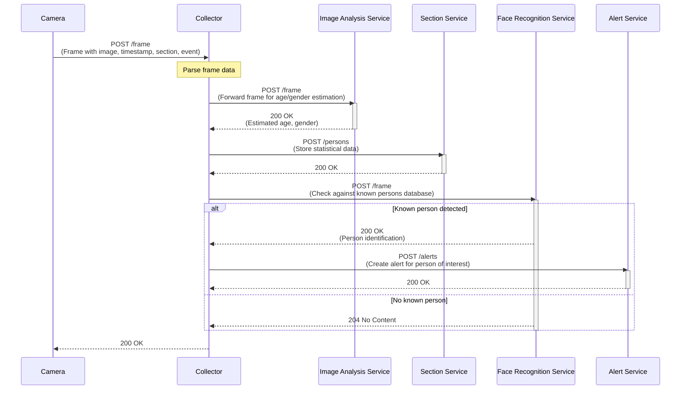
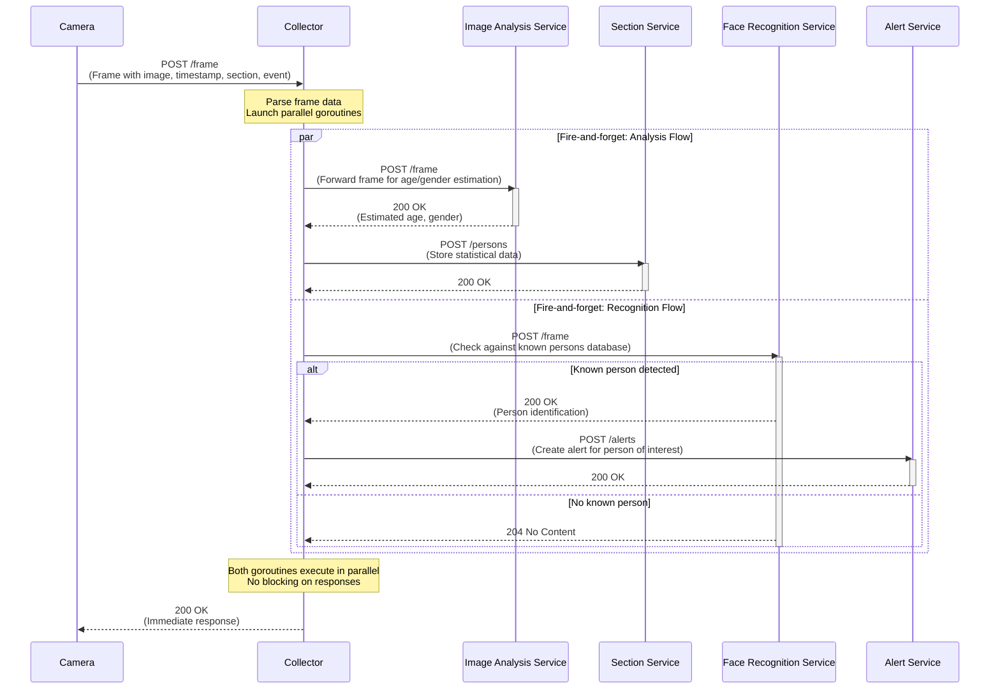
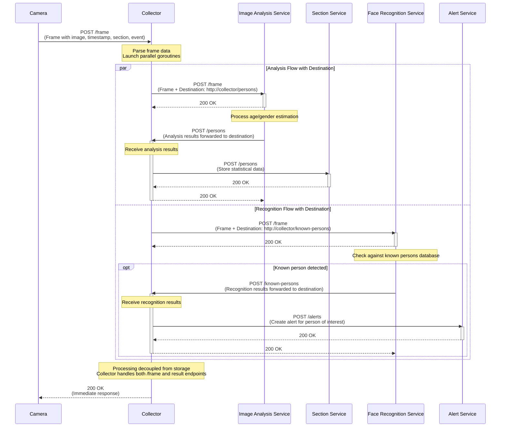

# Communication and data flow

## Implementation

After reviewing the requirements, I implemented the most straightforward 
solution: the collector service receives frame processing requests and executes 
two operations sequentially:

    1. Forward the frame to the Analysis service, wait for age/gender 
    estimation, then store results in the Section service
    2. Forward the frame to the Recognition service, wait for person 
    identification, then create alerts via the Alert service if needed

This naive approach had a critical performance bottleneck. Sequential execution 
meant each frame had to wait for the previous frame's analysis and recognition 
to complete before processing could begin. Since both Analysis and Recognition 
are CPU-intensive operations that can take several seconds per frame, the 
system could only handle a few frames per minute, making it unusable under 
realistic camera loads.

The first optimization was to execute both operations concurrently using 
goroutines. Since Analysis and Recognition have no data dependencies, they 
could run in parallel without coordination. This improved throughput by roughly 
2x — but the Collector still blocked on each frame until both CPU-intensive 
operations completed before accepting the next frame.

However, this still coupled frame ingestion with processing completion. The 
fundamental problem: Analysis and Recognition are long-running, CPU-bound 
tasks, while frame ingestion should be lightweight and fast. Further 
examination of the API specification revealed that the Collector service could 
expose two additional endpoints: `/known-persons` and `/persons`. More 
importantly, both Analysis and Recognition services accept an optional 
`Destination` field in their requests, allowing them to forward results 
directly to a specified URL once processing completes.

This insight revealed a better architecture: the Collector could function as 
both an ingest point for camera streams and a callback destination for 
processing results. The flow becomes:

    1. Collector receives frame from camera
    2. Collector immediately dispatches parallel requests to Analysis and 
    Recognition services, specifying its own `/persons` and `/known-persons` 
    endpoints as destinations, then returns 200 OK to the camera
    3. Analysis and Recognition services process frames asynchronously (taking 
    seconds or minutes depending on load)
    4. When processing completes, services POST results back to Collector, 
    which then persists them to Section and Alert services

This callback-based design decouples frame ingestion from result processing. 
The Collector can now accept frames as fast as cameras send them, while 
CPU-intensive analysis happens asynchronously. The system no longer stalls 
waiting for expensive computations — processing capacity is bounded by Analysis/
Recognition service resources, not by the Collector's ability to ingest frames.

## Service discovery

I developed and tested the system locally using Docker. In this phase, service
discovery was handled by Docker Compose's embedded DNS server — services could 
reach each other by using service names as hostnames (e.g., `http://analysis:8080`).

Moving to Kubernetes required updating service URLs but the underlying 
mechanism remained similar. Kubernetes also uses internal DNS for service 
discovery, managed by its control plane. I deployed each microservice with a 
corresponding Service object within a shared Namespace. Within a Namespace, 
services communicate using DNS names in the format `<service-name>:<port>`. I 
renamed services during migration (e.g., `http://analysis:8080` became `http://
analysis-service:7070`), but the pattern of DNS-based discovery stayed the 
same—both systems resolve service names to IP addresses automatically, just 
with different DNS implementations.

## Scalability and Bottlenecks

The system exhibits good horizontal scalability due to high request-level 
parallelism — frame processing requests are independent with no complex data 
dependencies between them. However, the assignment's constraints limit which 
components can actually be scaled.

Analysis and Recognition services are the only components under our control 
that benefit from horizontal scaling. These services are CPU-bound, performing 
computationally expensive operations (image analysis, face recognition) that 
can take seconds per frame. Critically, they are stateless — they don't
maintain databases, so replicas can be added without coordination overhead.

Under deployment testing, single replicas of Analysis and Recognition services 
proved insufficient — GKE workloads entered failing states, likely due to 
resource exhaustion or health check timeouts as request queues grew unbounded. 
Scaling to 3 replicas per service stabilized the deployments, with pods 
maintaining healthy status under load.

The primary obstacle to system scalability lies in the Section and Alert 
services, but we cannot address it directly. Both services aggregate data that 
must remain consistent: Section maintains unified statistics on age/gender 
demographics, while Alert tracks persons of interest. 

However:

    1. Alert service runs MongoDB directly inside its container, making 
    horizontal scaling impossible — multiple replicas would each maintain 
    separate, unsynchronized databases.

    2. Section service allows MongoDB configuration but lacks any sharding 
    implementation. Even with multiple Section replicas, all instances would 
    write to a single MongoDB instance, creating a write contention bottleneck 
    rather than distributing load.

In a production deployment, the correct approach would be externalizing the 
databases entirely — using managed MongoDB clusters with replica sets for high 
availability and sharded clusters for write scalability. The services would 
connect to these external databases rather than embedding them in containers. 
This would enable both horizontal scaling of the application layer and proper 
database architecture for handling high-throughput writes.

## Scalability Testing

I tested the system's load handling by reducing the delay between frame 
generation from a single camera rather than deploying multiple camera services. 
Even with zero delay between frames, the asynchronous implementation 
successfully processed the entire stream without dropping frames.

Regarding the scenario of 4 cameras streaming 100 frames each: the system will 
certainly *ingest* all 400 frames — the Collector's asynchronous architecture 
handles that easily. The scaled Analysis/Recognition services (3 replicas each) 
would eventually *analyze* all frames, though with significant latency if 
cameras stream continuously. The actual bottleneck would likely emerge at the 
Section and Alert services when attempting to *persist* results. These services 
run single MongoDB instances inside containers, creating potential write 
contention as all processed frames funnel into single database endpoints. 

Without instrumenting Section/Alert services, I cannot measure their actual 
write capacity. The system could handle 400 frames comfortably if database 
writes are fast, or it could saturate at far fewer frames if write latency is 
high.

# Deployment
## Configuring GKE Cluster

Manual GKE cluster configuration proved problematic. I attempted multiple 
configurations — 3 nodes with 4GB RAM each, then 3 nodes with 6GB RAM — but 
neither succeeded in deploying all services. Kubernetes consistently failed to 
schedule either Analysis or Recognition services, reporting insufficient 
resources despite setting CPU limits as low as 100m per pod.

I ultimately deployed to a GKE Autopilot cluster, which handled resource 
allocation automatically and deployed all services successfully.

## Kubernetes Architecture

The deployment uses four primary Kubernetes object types, each serving a 
specific purpose:

**Namespaces** provide logical isolation and enable DNS-based service 
discovery. Within a single Namespace, services can reference each other by name 
without fully qualified domain names.

**Deployments** manage pod lifecycle and resource constraints for each 
microservice. Every containerized service (Collector, Analysis, Recognition, 
Section, Alert) has a corresponding Deployment specifying replica counts, 
resource requests/limits, and health checks. Both readiness and liveness probes 
are configured — readiness probes prevent traffic routing to pods still 
initializing, while liveness probes restart unresponsive pods.

**Services** (type ClusterIP) provide stable internal endpoints for service 
discovery and act as load balancers, distributing traffic across pod replicas. 
Each Deployment has a corresponding Service exposing it to other components 
within the cluster. ClusterIP was chosen over NodePort or LoadBalancer since 
all communication is internal — no external access is required.

**HorizontalPodAutoscalers (HPAs)** manage dynamic scaling for Analysis and 
Recognition services based on CPU and memory utilization. These are the most 
computationally intensive services, performing image analysis and face 
recognition. HPAs scale each service up to 3 replicas when resource utilization 
exceeds defined thresholds. Resource constraints are explicitly defined in 
Deployment manifests: Analysis and Recognition services have higher CPU/memory 
requests and limits than the lightweight Collector, Section, and Alert services.

## Ingress

All external communication routes through a single Ingress resource. I initially 
attempted to use the `gce` Ingress class, which should integrate better with GKE 
managed clusters. However, configuration proved difficult — specifically around 
setting up the required default backend Service — so I switched to `nginx`.

The nginx-ingress-controller was installed via Helm, then configured to route 
traffic based on hostnames. The Ingress exposes four host-based routes:

    1. `airport-collector.io` → Collector service (frame ingestion endpoint for 
    cameras)
    2. `airport-camera.io` → Camera service (control interface to start/stop 
    streaming)
    3. `airport-section.io` → Section service (query demographic statistics)
    4. `airport-alerts.io` → Alert service (query person-of-interest alerts)

Each hostname routes to its corresponding ClusterIP Service, which load-balances 
across backend pods. For testing, requests are sent to the Ingress's external IP 
with custom `Host` headers in Postman (e.g., `Host: airport-collector.io`), 
allowing hostname-based routing without DNS configuration.

# Cost Analysis

## Resource Requirements

| Service         | Replicas | CPU Request | CPU Limit | Memory Request | Memory Limit | 
| --------------- | -------- | ----------- | --------- | -------------- | ------------ | 
| **Collector**   | 2        | 250m        | 500m      | 64Mi           | 128Mi        | 
| **Section**     | 1        | 250m        | 500m      | 128Mi          | 128Mi        | 
| **Alert**       | 1        | 250m        | 500m      | 128Mi          | 128Mi        | 
| **Recognition** | 1-3      | 500m        | 750m      | 512Mi          | 1024Mi       | 
| **Analysis**    | 1-3      | 500m        | 750m      | 512Mi          | 1024Mi       | 
| **Camera**      | 1        | 500m        | 500m      | 128Mi          | 128Mi        | 

There are two approaches to capacity planning: provisioning for average load 
(based on requests) or peak load (based on limits). The request-based 
calculation assumes typical utilization but risks underprovisioning during load 
spikes:

**Average Load (Requests):**
- CPU: 2×250m + 250m + 250m + 3×500m + 3×500m + 500m = 4500m ≈ 5 vCPU
- Memory: 2×64Mi + 128Mi + 128Mi + 3×512Mi + 3×512Mi + 128Mi = 3584Mi ≈ 4GB RAM

**Peak Load (Limits):**
- CPU: 2×500m + 500m + 500m + 3×750m + 3×750m + 500m = 7000m ≈ 7 vCPU  
- Memory: 2×128Mi + 128Mi + 128Mi + 3×1024Mi + 3×1024Mi + 128Mi = 6784Mi ≈ 7GB RAM

## Hardware vs Cloud Comparison

**Self-Hosted Hardware:**
Using consumer PC components, a system meeting average load requirements (Ryzen 
3 1200, 4GB RAM, 128GB SSD) costs approximately [$121](https://howmuch.one/pc-price-calculator?cpu=amd-ryzen-3-1200&gpu=&motherboard=average-amd-b350-motherboard-am4&ram=average-ddr4-3600-4gb&ram2=&ssd=average-ssd-128gb-nvme&hdd=&psu=average-300w-power-supply). For peak load (Ryzen 5 
1400, 8GB RAM), approximately [$132](https://howmuch.one/pc-price-calculator?cpu=amd-ryzen-5-1400&gpu=&motherboard=average-amd-b350-motherboard-am4&ram=average-ddr4-3200-8gb&ram2=&ssd=average-ssd-128gb-nvme&hdd=&psu=average-300w-power-supply). These are one-time capital expenses.

**GKE Cloud Costs:**
Using standard GKE compute (e2-standard-2 instances):
- Average load: ~3 nodes ≈ $132/month ($1,584/year)
- Peak load: ~4 nodes ≈ $152/month ($1,824/year)

At first glance, self-hosted hardware pays for itself in one month. However, 
this comparison ignores operational costs: electricity, cooling, network 
bandwidth, backup infrastructure, physical security, and maintenance labor. Over 
3 years (typical hardware lifecycle), total cost of ownership for self-hosted 
might approach cloud costs.

Though, for an airport security system specifically, self-hosted infrastructure 
makes sense due to data sovereignty requirements, predictable costs at scale, and 
independence from cloud provider availability. However, this assumes in-house 
expertise for infrastructure management—something most organizations lack.

**Serverless vs Containers vs VMs:**
For this workload, serverless (Cloud Run, Lambda) would be unsuitable — the system 
requires long-running processes handling streaming data, not event-driven 
functions. Kubernetes provides the right abstraction: fine-grained resource 
control, horizontal scaling, and service orchestration. Pure VM deployments 
would be simpler operationally but waste resources (entire VMs for lightweight 
services like Collector) and lack Kubernetes' automated scaling and self-healing 
capabilities.

## Grafana cluster

To monitor an application I have deployed a suggested on forum Grafana cluster.

# [Screenshots](./SCREENSHOTS.md)
 
# [Further cost estimations](./ESTIMATIONS.md)