# System Description

> - Implementation details, covering setup, your Kafka-based consumption service, and other pertinent aspects.

## Architecture

The primary goal of the `consumer` service is to handle the following workflow:

1. Pull messages/events from three Kafka topics
2. Map those events to MongoDB commands
3. Execute the resulting commands
4. Provide an HTTP gateway to the consumer database

To implement this workflow, I designed a three-package architecture:

- **`uv-kafka`**: Handles message consumption from Kafka. It uses the `confluent-kafka` package to connect to the Kafka cluster, subscribe to relevant topics, and deserialize incoming messages.

- **`uv-server`**: Provides an HTTP interface with handlers required by the assignment. Users can query specific document entries or retrieve the total document count in a collection. This package also implements Kubernetes liveness and readiness probes.

- **`uv-mongo`**: Manages connections and queries to the consumer database.

## Dataflow

To maximize concurrency, I used goroutines and channels for inter-module communication. The service flow is as follows:

1. `KafkaSubscription.ProcessMessagesLoop` runs in a goroutine, continuously polling updates from the pepper, tomato, and potato topics
2. Messages are deserialized into `LeafUpdateEvents` and pushed into a bounded channel
3. `MongoConnection.HandleMessage` listens to the channel
4. Upon receiving a message, it determines the source topic and upserts data into the corresponding collection

The following diagram illustrates the consumer architecture:

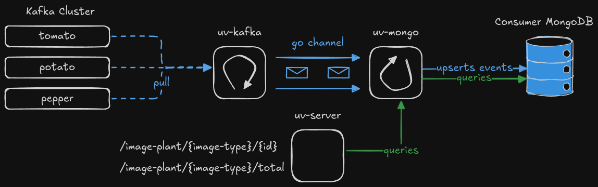

## Setup

The `consumer` service is configured via environment variables:

| Variable               | Purpose                       | Default Value               |
| ---------------------- | ----------------------------- | --------------------------- |
| KAFKA_BOOTSTRAP_SERVER | Kafka broker URL              | "localhost:9093"            |
| KAFKA_GROUP_ID         | Consumer group ID             | "test-group"                |
| MONGO_URI              | MongoDB connection string     | "mongodb://localhost:27018" |
| SERVER_PORT            | HTTP server port              | ":80"                       |

# Deployment

> - A description of the Kubernetes objects (such as deployments and services) and the types of services (NodePort, ClusterIP, or LoadBalancer) you implemented, along with their respective purposes and usage. 
> - Requirements for deployment: What modifications did you make to enable execution in GKE, if you did not develop directly on GCP?
> - Provide the detailed configuration of your cluster on GKE, if it differs from the specification.
> - Justify the amount of vCPU and memory required by your application.

## Kubernetes objects

There are two systems to deploy: LIMS (including the consumer) and metrics. 

For LIMS deployment, I used 3 main Kubernetes objects for the `consumer` service. First, a *Deployment* that specifies resource constraints, replica count, and provides configuration via environment variables. It also sets up readiness and liveness probes. Second, a *Service* of type `ClusterIP` that acts as an internal proxy for the `consumer` *Deployment*. Per the requirements, I'm running only 1 replica of `consumer`, but if there were multiple, the *Service* would handle internal load-balancing. Finally, an *Ingress* that exposes the `consumer` service externally — it simply makes the entire API accessible from outside the cluster.

The metrics deployment was trickier since I couldn't get Grafana running with the provided manifests. To fix this, I made 3 modifications: added an explicit *StorageClass* of type `hyperdisk-balanced` (the only storage type [compatible with N4 machines](https://discuss.google.dev/t/compute-vm-instance-n4-standard-16-with-attached-disks/156525/2)), modified `grafana-pvc` to request `10Gi` (since `hyperdisk-balanced` requires a minimum of 4Gi), and added a separate *Ingress* object to enable external access to the dashboard.

## Deployment

I stuck with the provided deployment framework and modified 4 files to incorporate the manifests described above:

| Script                  | Purpose                             | Change                                                                                                                                                                                         |
| ----------------------- | ----------------------------------- | ---------------------------------------------------------------------------------------------------------------------------------------------------------------------------------------------- |
| `start.prod.sh`         | Deploy LIMS with `consumer` service | [Added `consumer` deployment objects](https://gitta-lab.cs.univie.ac.at/cc25w/a12347073/-/commit/0928f9b8c8afeea7fed0eda3b955bbe06818e9b2#9a0066cf82774d926fa1986140f3d065eab410c1) |
| `stop.prod.sh`          | Destroy LIMS                        | [Added `consumer` cleanup objects](https://gitta-lab.cs.univie.ac.at/cc25w/a12347073/-/commit/0928f9b8c8afeea7fed0eda3b955bbe06818e9b2#d5f2be19c2287c937a59b2e2df355c5844faae56)     |
| `start-metrics.prod.sh` | Deploy Grafana dashboard            | [Added Ingress object and modified PV/PVC setup](https://gitta-lab.cs.univie.ac.at/cc25w/a12347073/-/commit/7ed7320d40ecb055dfac43f46b98ab7fb037c5d9)                              |
| `stop-metrics.prod.sh`  | Destroy Grafana dashboard           | [Added Ingress and PV/PVC cleanup](https://gitta-lab.cs.univie.ac.at/cc25w/a12347073/-/commit/7ed7320d40ecb055dfac43f46b98ab7fb037c5d9)                                                                                                                                              |

To deploy the system with the dashboard, run:

```bash
sh start.prod.sh a12347073
sh start-metrics.prod.sh a12347073
```

## Cluster configuration and resource justification

I deployed the system on a cluster with 2 N4 machines (matching the assignment specification). Through testing, I found that 1 N4 machine isn't sufficient to run both LIMS and the Grafana dashboard, so 2 nodes were necessary.

# Scalability

> - An explanation of the opportunities for scalability of the current system and possible bottlenecks, answering the following questions: 
> 	* Is your service scalable? If so, how can you scale your service up or down?
> 	* What would happen if the intensity of dataflow increased and the number of added or modified photos in the Kafka cluster rose? 
> 	* How can you improve the represented batch-approach to closely approach the efficiency of stream-processing? Why is stream-processing considered better than batch processing?
> 	* How would you describe your approach to scaling your application on GKE?

## Scalability and bottlenecks

To answer the scalability question, I'll break down the system into its 3 main components: LEAF, Kafka, and Consumer.

The LEAF system itself is easily scalable in both batch and stream processing forms. It consists of loosely coupled microservices with high request-level parallelism — each image is processed independently. Based on these properties, the LEAF component can scale both horizontally and vertically without issues.

The Consumer service also scales well since it's essentially a stateless transmitter between Kafka and MongoDB. There are no barriers to adding more replicas.

Kafka is scalable by design, so no concerns there.

Now for the interesting part: bottlenecks. From my perspective, there's one significant bottleneck: MongoDB. Since the system uses unmanaged MongoDB instances, it could lead to read/write congestion if RPS is high enough. The system might drop some events or halt while competing for database access. To fix this, I'd suggest using a managed instance with multiple replicas for better throughput and failover.

## Batch vs stream processing

Strictly speaking, there's no inherently better approach between batch and stream processing — each has its own benefits and drawbacks. However, in the context of leaf monitoring, stream processing is advantageous because it provides lower latency, leading to faster reaction times (the disease won't spread as quickly) and more predictable load. That said, given that the batch job runs every 10 minutes and Kafka batches events internally anyway, the real-world difference in our specific case is minimal.

To bridge the small gap between batch and stream processing in our setup, one could either batch only changes (transferring less data) and run the synchronizer job more frequently (every 5 minutes instead of 10).

## GKE scaling

For GKE scaling, I would employ *HorizontalPodAutoscaler* objects to automatically adjust replicas based on CPU/memory metrics or custom metrics like Kafka consumer lag. This would allow the system to scale up during peak loads and scale down during quiet periods, optimizing resource usage.

# Challenges during development

> - A description of the challenges faced during your development and deployment.

I faced multiple challenges during development, but here are the most memorable ones:

## librdkafka

There are essentially two ways to interact with Kafka: via the officially maintained Java client or through the Confluent-maintained client, which wraps C/C++ Kafka libraries. The latter approach is more tedious since the C/C++ library has to be present during both container build and execution. It turned out that the [Alpine image I used previously doesn't include it](../a1/collector/Dockerfile). I spent quite some time debugging my deployment and eventually switched to Debian-based containers to solve the issue.

## Grafana deployment

When I tried to deploy the dashboard, I constantly hit an "insufficient provision capacity" error for the Grafana deployment. This was puzzling because Grafana was already included in the assignment, so I initially suspected I needed to allocate a larger cluster. It turned out the issue was more nuanced — N4 machines don't support default volume types. After reading through forums and tinkering, I had to explicitly create a new *StorageClass* of type `hyperdisk-balanced` and modify the *PVC* to claim more space (the minimum for that type is 4Gi). After making these changes, Grafana deployed successfully.

# Cost estimations

> - A discussion of the annual costs associated with provisioning the full cluster:
>    * In your estimation, which would be more costly on GKE: utilizing a batch solution or adopting an event-driven architecture? Please provide a rough calculation of the annual expenses. 
>    * How do you think this compares to the costs of purchasing and maintaining your own hardware?

As I mentioned in the Deployment section, I had to utilize 2 N4-standard-4 machines to efficiently run the whole system plus metrics. According to the price calculator at cluster creation, this configuration costs [$153](./screenshots/cluster-cost.png)/month, or roughly **$1,836/year**. 

For comparison, a PC with similar specs (4 vCPU + 16 GB RAM) would cost around [$141](https://howmuch.one/pc-price-calculator?cpu=amd-ryzen-3-1200&gpu=&motherboard=average-amd-b350-motherboard-am4&ram=average-ddr4-3600-8gb&ram2=average-ddr4-3600-8gb&ssd=average-ssd-128gb-nvme&hdd=&psu=average-300w-power-supply) in hardware — almost comparable to the monthly cost of the GKE cluster. If we consider only CAPEX, it's obviously cheaper to buy a PC (though the unfolding RAM crisis might change this calculation). However, once OPEX is factored in — including electricity costs, cooling, network bandwidth, and maintenance — the cloud becomes more competitive, as cloud providers generally offer more computation per dollar due to economies of scale.

Regarding the batch vs. event-driven approach, I would estimate that the batch solution would be cheaper, mainly because event processing requires an additional Kafka cluster to function properly. The batch approach can work with simpler infrastructure since it only needs periodic synchronization rather than continuous event streaming.

# Screenshots

| Screenshot                                                                                                  | Screenshot                                                                                              |
| ----------------------------------------------------------------------------------------------------------- | ------------------------------------------------------------------------------------------------------- |
| 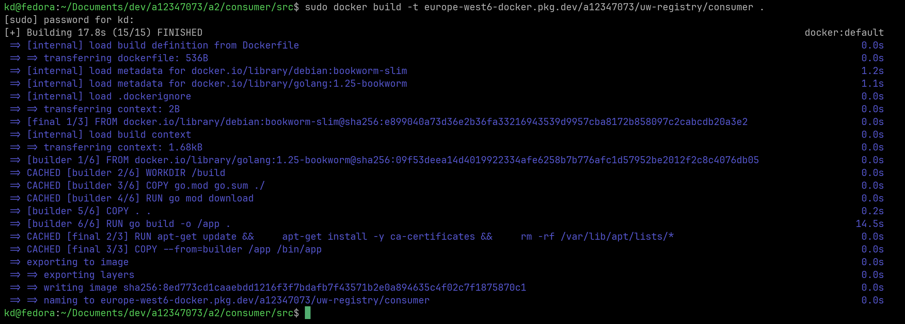<br>Building the consumer Docker image | 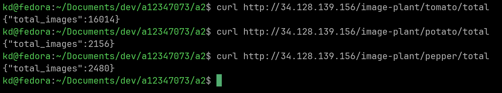<br>Testing the total count endpoint |
| 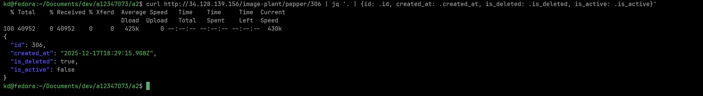<br>Querying the pepper endpoint                       | 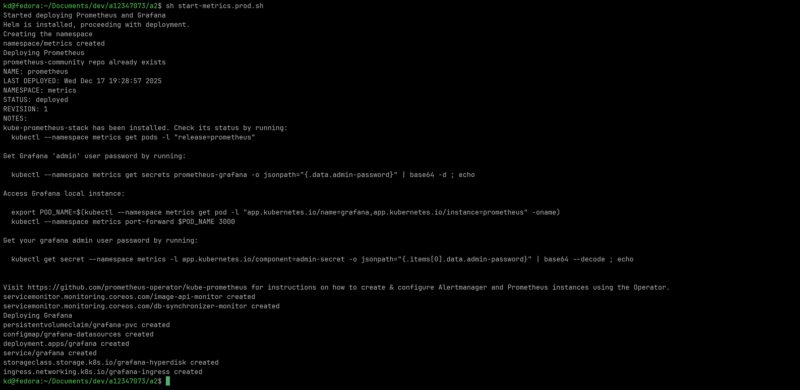<br>Grafana deployment process                 |
| 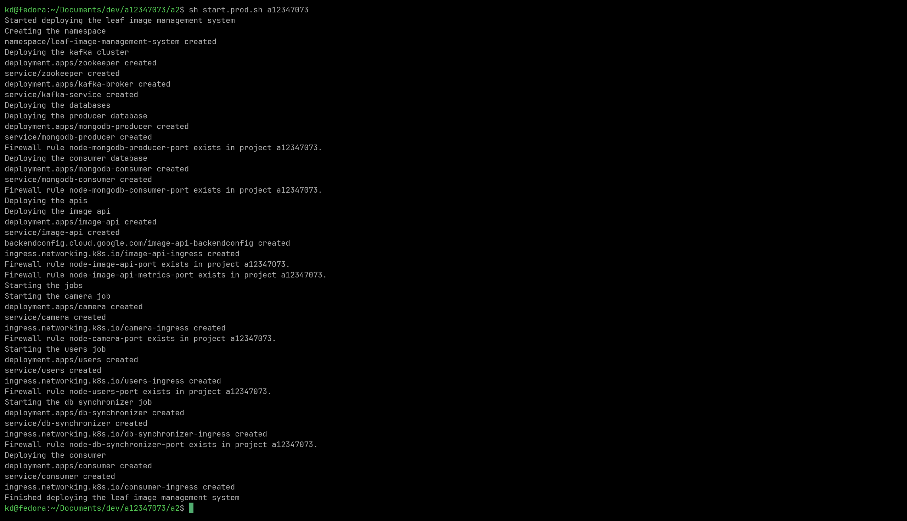<br>LEAF system deployment                               | 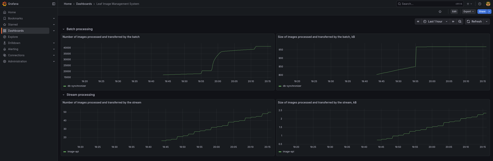<br>Grafana monitoring dashboard                         |
| 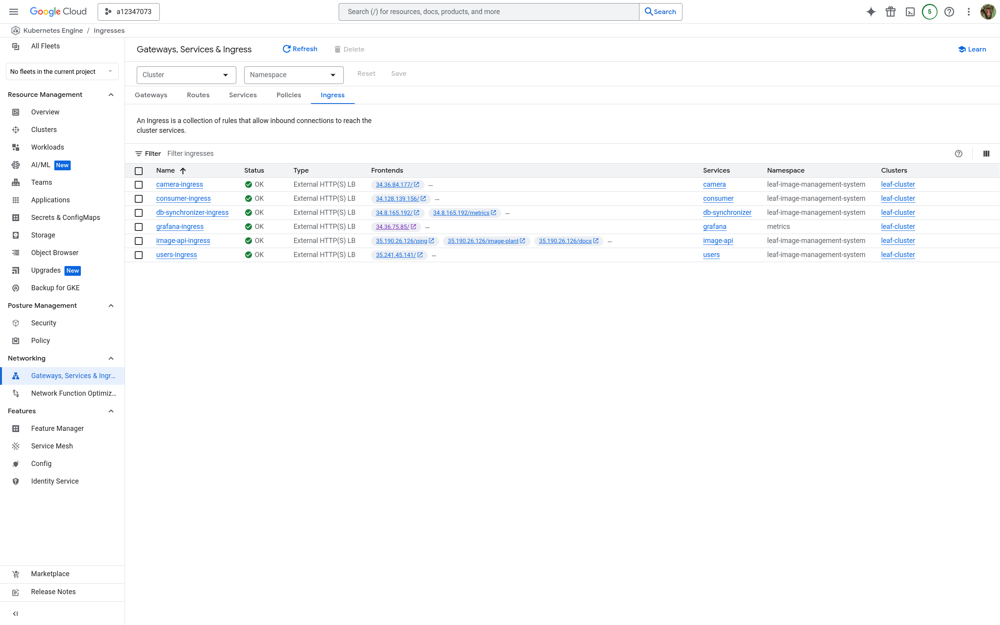<br>Configured ingress resources                                   | 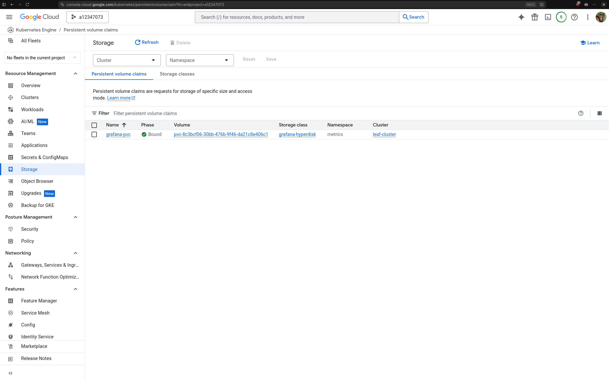<br>Persistent Volume Claims                                             |
| 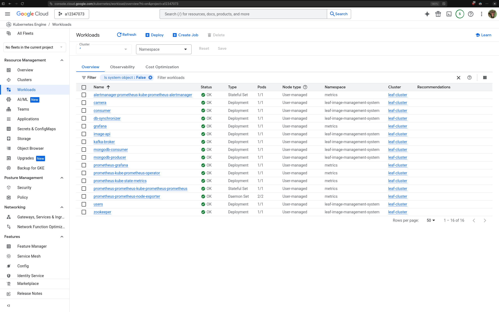<br>All deployed workloads in the cluster        | 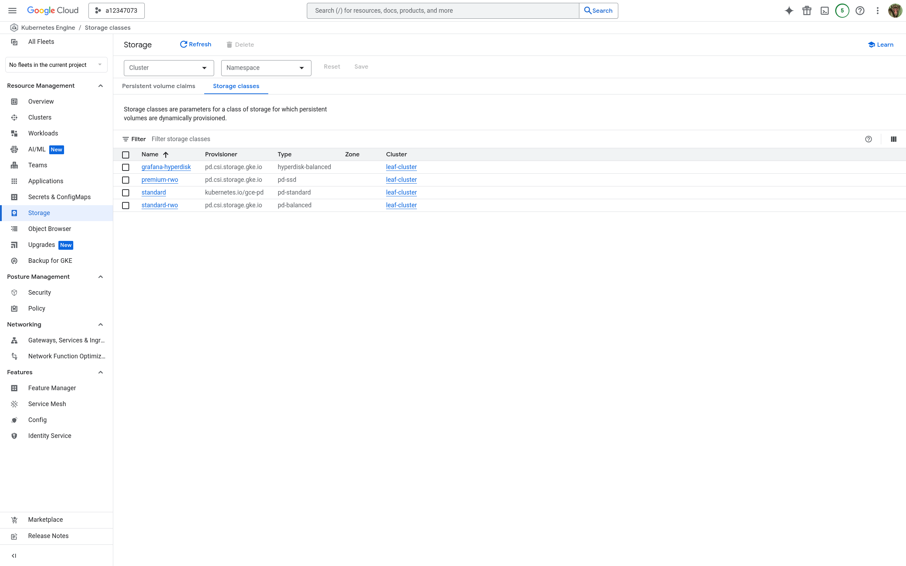<br>Storage configuration                                         |

